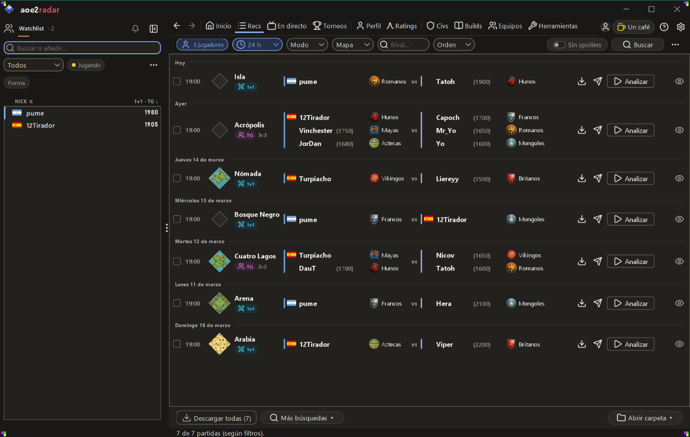
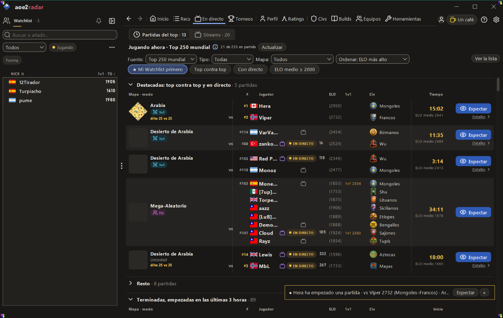
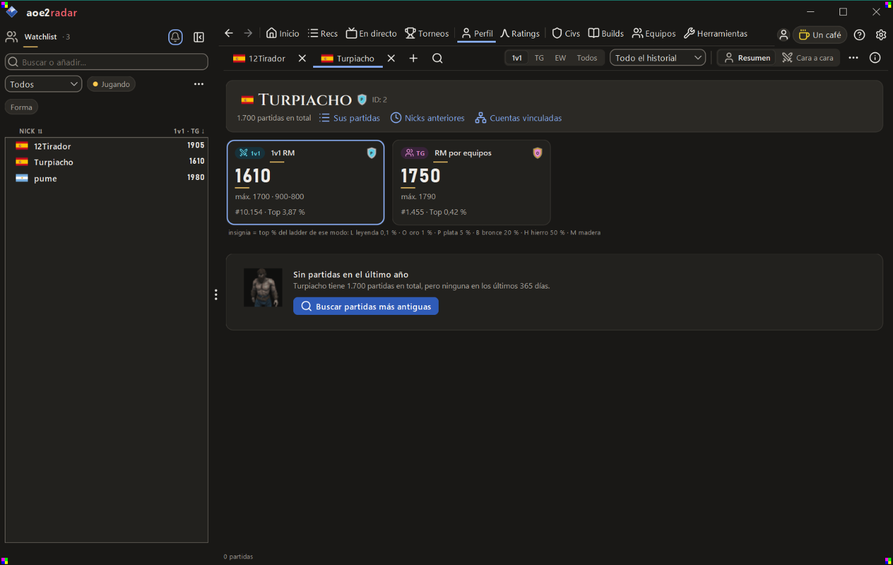
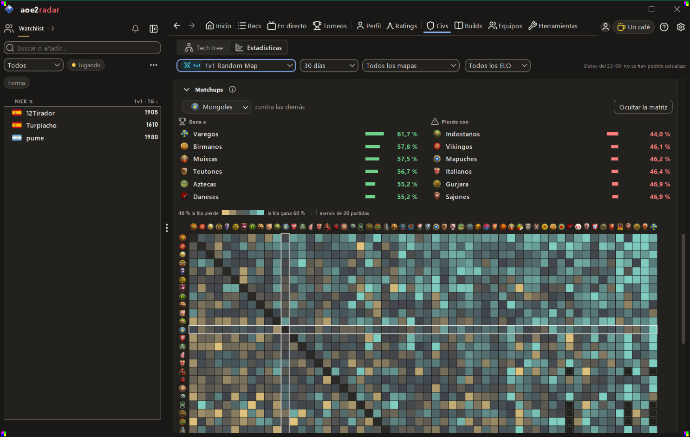

# aoe2radar

Your radar for competitive Age of Empires II, without spoilers.

🇪🇸 Español: [ver más abajo](#español)

---

## What it is

aoe2radar is a Windows desktop app for Age of Empires II: Definitive Edition.
It lets you follow players and their matches without learning the result before you want to.

**Everything you need for AoE2... and more than you imagined.**

*Everything you need*
- **Watchlist**: the players you follow, in groups, with their recent form; it shows when they are playing (against
  whom, on which map, with what ELO).
- **Any player's ELO and profile**: civs, maps, speed (eAPM), head-to-head and match history.
- **Spoiler-free recs opened in the game in one click**: download the rec and send it to AoE2 (it shows up under Saved
  games); the eye on each game reveals the result only when you ask.
- **Live games and streams**: top games with *Spectate*, and streams on Twitch, YouTube and Kick.

*...and more than you imagined*
- **"My game"** when a match starts: your opponent's 1v1 and team-game ELO, their main account if they are a smurf,
  and the civs they played lately.
- **Build orders over the game**: 38 build orders (Hera, TaToH, Sebastian, Morley and more) shown on top of the game
  that advance by themselves following the game clock.
- **Battles with your upgrades, sent to the game**: simulate a fight in Combat and test it as a scenario in AoE2
  (Editor > Load scenario).
- **Balanced teams and leagues with friends**: teams by ELO, a signed league code to join, and results that count by
  themselves from the games you play.

*And much more*
- **Tournaments**: upcoming events, an "internal Liquipedia" (sheets, brackets, results, your next match) and the
  community tournaments of gamenex.gg.
- **Every ladder** (Ratings > Clasificación): all modes, by country, with pages.
- **Civ stats, Tech tree, Builds and Villagers** (how many per resource).
- **Match viewer (BETA)**: a game on the map with per-player fog, speeds and charts. It still has known bugs.

Data comes from [aoe2companion](https://www.aoe2companion.com) (API and live matches),
[aoe2techtree](https://www.aoe2techtree.net) and [Liquipedia](https://liquipedia.net/ageofempires/) (tournaments).
Every night, the `sfr-data` repository builds summaries and precomputed profiles (and the tournament, stream and
community-tournament lists), so the app does not depend only on the API when you open it.

## Screenshots

| Watchlist and matches | Live now |
|---|---|
|  |  |

| Player profile | Civ Stats |
|---|---|
|  |  |

## Installation

1. Go to [Releases](https://github.com/jguardiola-dev/aoe2radar/releases/latest) and download
   `aoe2radar-X.Y-setup.exe` of the latest version.
2. Run it. It installs for your Windows user only, **without administrator rights**, in
   `%LOCALAPPDATA%\Programs\aoe2radar`, with an entry in the Start menu (and a desktop shortcut if you tick the
   box). The installer speaks English or Spanish, following Windows.
3. Windows SmartScreen may warn that the program is not signed ("Windows protected your PC"). This is expected:
   the installer has no code-signing certificate yet. Click **More info** → **Run anyway**.
4. To uninstall: Windows Settings → Apps → aoe2radar → Uninstall. The program is removed, but **your data is
   not** (the uninstaller tells you where it is, in case you want to delete it by hand).

Running a newer installer over an installed version updates it: it closes the app if it is open, replaces the
program and keeps your data.

### Automatic updates

The installed app looks for a new version a few seconds after it starts and every 12 hours, and downloads it in
the background. When it is ready, a thin bar at the top of the window says *"aoe2radar X.Y is ready: it will be
applied when you close the app"*, with a **Restart now** button; nothing else interrupts you. The update is
applied when you close the app and used the next time you open it. If that first start fails, the app goes back
to the previous version by itself and tells you.

Some versions need more than the program itself (a new bundled Java, for instance). Then the bar says *"There
is a new version that needs reinstalling"* and **Download installer** opens the release page: download and run
the new installer.

To decide yourself, turn off **Configuración** (Settings) → **Update automatically**: the bar then only tells
you that a version is available, with an **Update** button.

### Coming from a 1.x zip

Install with the installer as above. The first time it starts, the app looks for old copies of aoe2radar 1.x
(or SpoilerFreeRecs) on your Desktop, in Downloads and in Documents, up to four folders deep. If it finds any, it
proposes the newest version ("Found 28 copies of aoe2radar 1.x. The newest is 1.3 in …") with **Import**,
**Choose another folder…** and **No, thanks**. If it finds none, it asks nothing: use **Configuración** →
**Import data from another version…** and pick the old folder (the one you unzipped is enough, the app finds the
data inside it). Your groups, settings, caches and
recs are copied (the old folder is left untouched, and you can delete it afterwards). You can also do
it later in **Configuración** → **Import data from another version…**; if you already have data in the new
version, it asks first and keeps a copy of it in `%APPDATA%\aoe2radar\.antes_de_importar`. The app then
restarts. If the old version started with Windows, turn that off in it (or delete it) so you don't get both.

### Zip, without installer

Each release also has `aoe2radar-X.Y-windows.zip`, for those who prefer no installer (or a USB stick): unzip it
into a folder of its own and open `aoe2radar.exe` (same SmartScreen warning as above). In a folder you can write
to, it updates itself like the installed app; otherwise it just tells you when there is a new version.

### Where your data lives

- Settings, player list, log and caches: `%APPDATA%\aoe2radar` (usually
  `C:\Users\<you>\AppData\Roaming\aoe2radar`), not the program folder. This way the program can live in a
  folder you cannot write to and an update never touches your data.
- Downloaded recs: `Documents\aoe2radar\recs` (your real Documents folder, also when OneDrive moves it).
- **Portable mode**: to keep everything next to the `.exe` (for example, on a USB stick), create an empty file
  named `portable` (or `portable.txt`) in the same folder as `aoe2radar.exe`. The app then reads and writes
  its data and recs in that folder, as versions 1.1 to 1.3 did.

The app includes its own Java runtime, so there is nothing else to install. It is available in Spanish and
English; you can switch the language in **Configuración** (Settings).

## Basic usage

- Add players to the Watchlist by searching for their nickname, and put them in groups (clan, tournament...).
- In **Recs**, look up their games: the result stays hidden until you click the eye. Download the rec and send it
  to the game with the plane button; it appears under *Saved games* in AoE2.
- Start a game and **My game** shows your opponent's ELO (1v1 and TG), main account and latest civs.
- In **Builds**, pick a build order and press *In game*: it is shown over the game and follows its clock.
- In **Live** you see who is playing now (*Spectate* in one click) and who is streaming.
- **Tournaments** lists upcoming and past events with brackets and results.
- **Ratings > Clasificación** browses every ladder by mode and country.
- In **Teams**, create a league (or join one with a code) and balance teams from your Watchlist.
- **Combat** simulates battles; *Try it in-game* turns one into a scenario. **Villagers**, **Civs** and **Tech tree**
  help you prepare.
- The **?** button opens a short guide with a *Try it* shortcut on each step. Ctrl+1 ... Ctrl+0 jump between tabs.

## Privacy

What the app stores on disk, in `%APPDATA%\aoe2radar` (recs in `Documents\aoe2radar\recs`; everything next
to the `.exe` in portable mode, see [Where your data lives](#where-your-data-lives)):
- `config.properties`: your settings (including your game account, if you set it).
- `players.txt`: the list of players you follow.
- `liguillas.json` (and a `.bak` copy) and `liguillas_clave.json`: the leagues you created or joined, and the key
  of the leagues you created. They never leave your PC; a league code is only shared if you hand it over.
- `recs/`: the recorded games you download (plus `descargas.log`, the download history).
- `sfrdata/` and other `.json` files: local caches (profiles, ladder, tech tree, civ stats, tournaments, streams...),
  so the same data is not downloaded twice.
- If you use "Send to game", the rec is copied into the `savegame` folder of your Age of Empires II DE profile.
- The overlay and *My game* read the game's own log on your PC; nothing from it is uploaded.

**Feedback & bug reports** (⚙ menu, About, and the BETA notice in the viewer): the window never sends anything by itself. Only if you press a button does it open your browser with your text (and, if you leave the box ticked, technical data: app, Windows and Java versions, language, scale, window size, current tab and the last 40 log lines with your user folder and tokens removed; never `config.properties`) pre-filled in a Google Form (only the author reads it) or a GitHub issue (public, needs a GitHub account). You review it and press Send there; "Copy" just puts the text on the clipboard.

Services the app connects to on its own. All are plain public requests (a URL, a player or match ID that is
already public); **none receives your name, e-mail, files or any identifier of yours**:
- **aoe2companion** (`data.aoe2companion.com`, the `socket.aoe2companion.com` socket,
  `api.aoe2companion.com/twitch/live` and `cdn.aoe2companion.com`): matches, Live, profiles, ladders, the list of
  Twitch channels and map images.
- **aoe.ms**, Age of Empires II's own service, to download recs.
- **aoe-api.worldsedgelink.com** (World's Edge/Microsoft), to check whether you have a match of your own in
  progress.
- **steamcommunity.com** and **avatars.steamstatic.com**, for a player's previous names and Steam avatar (only
  their public Steam ID is used).
- **cdn.ageofempires.com** and **www.ageofempires.com**: official images and news links.
- **Twitch** (`static-cdn.jtvnw.net`), **YouTube** (`i.ytimg.com`, `yt3.ggpht.com`, `yt3.googleusercontent.com`)
  and **Kick** (`*.kick.com`): thumbnails and avatars of live streams. The list of who is live is built by
  `sfr-data`, not by your PC.
- **GitHub** (`raw.githubusercontent.com`, `api.github.com`, `github.com` and its download server): the nightly
  `sfr-data` data (summaries, profiles, tournaments from Liquipedia, community tournaments from gamenex.gg,
  streams), the `aoe2techtree` data, and the new-version check and download. GitHub sees your IP address, as any
  web server does.
- **liquipedia.net**, **gamenex.gg** and **aoe2insights.com**: links that open in your browser when you click
  them (a tournament page, a player or match page). Tournament data and logos reach the app through `sfr-data`.
  (`ugc.aoe2.rocks` and the Age of Empires wiki are only sources of the combat formulas, cited in the code; the
  app never contacts them.)

Some menus open links in your browser, but only when you click them (a player's page on aoe2companion or
aoe2insights, their Twitch channel, a tournament on Liquipedia or gamenex.gg, the "buy me a coffee" link,
Microsoft's Game Content Usage Rules in About and in the tech tree). The app never opens them on its own.

aoe2radar needs no user account, has no analytics or telemetry, and sends no personal data to anyone.

## Credits

- Match and profile data: **aoe2companion**, by Dennis Keil.
- Technology tree: **aoe2techtree**, by HSZemi (MIT license for its code and data; the icons and game
  text are Microsoft's, used under the Game Content Usage Rules below).
- Flags: [hampusborgos/country-flags](https://github.com/hampusborgos/country-flags) (public domain).
- UI: **FlatLaf** (Apache 2.0 license).
- Bundled Java runtime: **OpenJDK** (GPLv2 with Classpath Exception).
- Match spectating: **CaptureAge**.
- Streams: **Twitch**, **YouTube** and **Kick** (the live list is built by sfr-data).
- Tournaments: **Liquipedia** (CC BY-SA 3.0; logos belong to their owners and are used under fair use) and the
  community tournament list of **gamenex.gg** (with their organizers' logos).
- Player pages: links to **aoe2insights** and **aoe2companion**.
- Build orders: by their creators (Hera, Daut, TaToH, Sebastian, Morley Games...), most found thanks to **AoE Buddy**;
  each one links its video.
- Inspiration for the combat simulator (upgrade layout and damage breakdown): **aoe2database**, by Pau795
  ([pau795/AoE2DatabaseWeb](https://github.com/pau795/AoE2DatabaseWeb), Unlicense). No code was copied.
- Idea of the villager calculator, and its farm and pasture rates with each upgrade: **aoe2-de-tools**, by Survivalist
  ([villagers-required](https://aoe2-de-tools.herokuapp.com/villagers-required);
  [PeterWhiteJavascript/aoe2-de-tools](https://github.com/PeterWhiteJavascript/aoe2-de-tools)). Only numbers were
  taken, each one cited in its row; no code was copied.
- Gathering rates and carry capacities of the villager calculator: **Age of Empires Series Wiki**
  (https://ageofempires.fandom.com, CC BY-SA 3.0). Only numbers were taken, each one cited in its row.

Full license texts and notices for everything bundled: [THIRD_PARTY_NOTICES.md](THIRD_PARTY_NOTICES.md).

Age of Empires II © Microsoft Corporation. aoe2radar was created under Microsoft's "Game Content Usage
Rules" using assets from Age of Empires II, and it is not endorsed by or affiliated with Microsoft.
See Microsoft's [Game Content Usage Rules](https://www.xbox.com/en-US/developers/rules).

## License

aoe2radar is free to download and use, but its source code is not public: see [LICENSE](LICENSE).
Versions up to 1.5 were published under the MIT license.

## Author

Jorge «12Tirador» Guardiola — [twitch.tv/12tirador](https://twitch.tv/12tirador)

---

## Español

aoe2radar es una app de escritorio para Windows para Age of Empires II: Definitive Edition. Sirve para
seguir a jugadores y sus partidas sin enterarte del resultado antes de tiempo. La app está en español y en inglés
(se cambia en **Configuración**).

**Todo lo que necesitas para AoE2... y más de lo que imaginabas.**

*Todo lo que necesitas*
- **Watchlist**: los jugadores que sigues, en grupos y con su forma reciente; te enseña cuándo juegan (contra quién,
  en qué mapa y con qué ELO).
- **ELO y perfil de cualquier jugador**: civs, mapas, velocidad (eAPM), cara a cara e historial.
- **Recs sin spoilers abiertas en el juego con un clic**: descargas la rec y la mandas a AoE2 (sale en Partidas
  guardadas); el ojo de cada partida revela el resultado solo cuando tú quieres.
- **Partidas en directo y streams**: partidas del top con *Espectar* y directos de Twitch, YouTube y Kick.

*...y más de lo que imaginabas*
- **«Mi partida»** al empezar: ELO del rival en 1v1 y TG, su cuenta principal si es smurf y las últimas civs que ha
  jugado.
- **Build orders sobre el juego**: 38 build orders (Hera, TaToH, Sebastian, Morley y más) que pasan de paso solas
  con el reloj de la partida.
- **Batallas con tus mejoras, enviadas al juego**: simulas el combate y lo pruebas como escenario en AoE2
  (Editor › Cargar escenario).
- **Equipos igualados y liguillas con amigos**: equipos por ELO, código de liga firmado para unirse y resultados que
  cuentan solos con las partidas que juegas.

*Y mucho más*
- **Torneos**: próximos, con una «Liquipedia interna» (fichas, cuadros, resultados, tu próximo partido) y los torneos
  de la comunidad de gamenex.gg.
- **Todas las clasificaciones** (Ratings › Clasificación): modos, país y páginas.
- **Estadísticas de civs, Tech tree, Builds y Aldeanos**.
- **Visor de partidas (BETA, con fallos conocidos)**.

Instalación:
1. Descarga `aoe2radar-X.Y-setup.exe` de la última versión en
   [Releases](https://github.com/jguardiola-dev/aoe2radar/releases/latest).
2. Ejecútalo: instala solo para tu usuario, sin permisos de administrador, en
   `%LOCALAPPDATA%\Programs\aoe2radar` (lleva su propio Java). Si Windows avisa de que no está firmado, pulsa
   **Más información** → **Ejecutar de todas formas**.
3. Para desinstalar: Configuración de Windows → Aplicaciones. Tus datos no se borran.

Actualizaciones: la app instalada busca versiones nuevas al arrancar y cada 12 horas, y las descarga sola. Cuando
hay una lista, una franja arriba lo dice («se aplicará al cerrar», con **Reiniciar ahora**); si el primer
arranque con la nueva falla, vuelve sola a la anterior. Si una versión necesita reinstalar, la franja ofrece
**Descargar instalador**. Con **Configuración** → **Actualizar automáticamente** apagado, solo avisa. También
se publica el zip, para quien no quiera instalador.

Tus datos (configuración, jugadores, log y cachés) se guardan en `%APPDATA%\aoe2radar`, y las recs en
`Documentos\aoe2radar\recs`. Si vienes de una 1.x en zip, el primer arranque busca copias viejas en el
Escritorio, Descargas y Documentos y te propone la versión más nueva; si no encuentra ninguna, no pregunta
nada: usa **Configuración** → **Importar datos de otra versión…** y elige la carpeta vieja (basta la que
descomprimiste). Modo portátil: crea un archivo vacío `portable` (o `portable.txt`) junto a `aoe2radar.exe` y
todo se queda en esa carpeta, como antes.

Sugerencias y fallos (menú ⚙, Acerca de y el aviso BETA del visor): la ventana no envía nada sola. Solo si pulsas un botón abre tu navegador con tu texto (y, si dejas la casilla marcada, datos técnicos: versiones de la app, Windows y Java, idioma, escala, tamaño de ventana, pestaña y las últimas 40 líneas del log sin tu carpeta de usuario ni tokens; nunca `config.properties`) prellenado en un Google Forms (solo lo lee el autor) o en un issue de GitHub (público, necesita cuenta). Tú lo revisas y pulsas Enviar allí; «Copiar» solo lo deja en el portapapeles.

Privacidad: la app no necesita cuenta, no tiene analíticas ni telemetría y no envía datos personales. Se
conecta solo a servicios públicos, con peticiones que no llevan nada tuyo: aoe2companion (partidas, perfiles,
clasificaciones, mapas), aoe.ms (descarga de recs), World's Edge (tu partida en curso), Steam (nombres anteriores
y avatar), cdn.ageofempires.com (imágenes oficiales), Twitch, YouTube y Kick (miniaturas de directos) y GitHub
(los datos nocturnos de sfr-data, que incluyen torneos de Liquipedia, torneos de gamenex.gg y directos; los datos
de aoe2techtree; y las actualizaciones). Liquipedia, gamenex.gg y aoe2insights se abren como
enlaces cuando los pulsas. En tu PC se guardan en `%APPDATA%\aoe2radar`: configuración, lista de jugadores,
liguillas (y su clave, si creaste la liga), cachés y log; las recs, en `Documentos\aoe2radar\recs`. Créditos y
licencia: ver las secciones en inglés de arriba.
